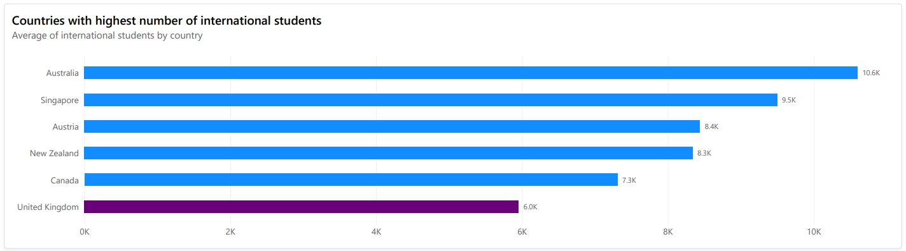
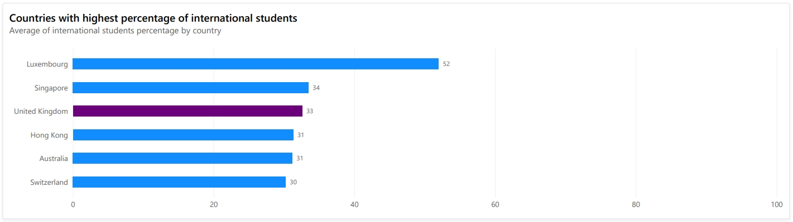
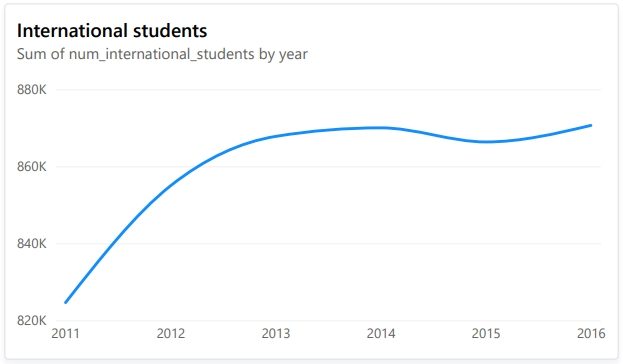
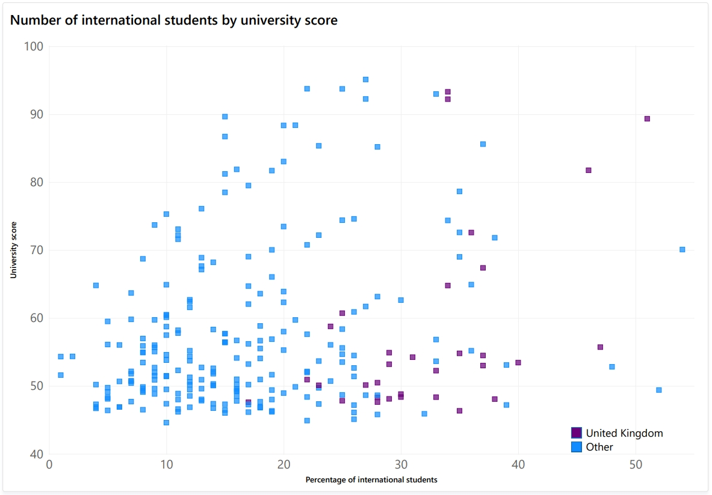

# International students and UK universities

**Author:** Ruth Evans
**Licence:** MIT

---
An exploratory data analysis examining world wide university data.

The project ends in a report in the form as a power BI dashboard.
Data spans the years 2011-2016

## Project Overview
A look at trends in international students in relation to UK universities.

## Repository Structure

```
education-analyst/
│
├── Assets/                          # Reports and visual outputs from the analysis
│   ├── pg1_int_students_amt.jpg
│   ├── pg2_int_students_trend.jpg
│   ├── pg2_percent_of_int_students.jpg
│   ├── pg3_university_scores.jpg
│   ├── pg4_uk_universities.jpg
│   └── universities_dashboard.pdf
│
├── Dashboard                        # Power BI Dashboard for the data analysis
│   ├── universities_dashboard.pbix
│   └── Assets/
│       └── Imperial_College_Business_School.jpg
│       └── Oxford_-_Balliol_College_-_geograph.org.uk_-_1329613.jpg
│
├── Dataset/
│   ├── Clean/                       # Cleaned version of the dataset
│   │   └── timesData.xlsx
│   └── Raw/                         # Original / raw version of the dataset
│       └── timesData.csv
│
├── Docs/                            # Project documentation and reports
│   ├── ANALYSIS_APPROACH.md         # Detailed step-by-step analysis methodology
│   └── data_cleaning_m_code.txt     # A copy of the m-code used to clean timesData.csv
│
├── LICENSE                          # MIT License
├── README.md                        # Project overview and documentation
```
## Analysis Approach
A complete step-by-step breakdown of the analytical methodology used in this project is available here:

**→ [Docs/ANALYSIS_APPROACH.md](Docs/ANALYSIS_APPROACH.md)**

## Dataset Information

**File:** `timesData.csv`

| Column              | Description                                      |
|---------------------|--------------------------------------------------|
| world_rank          | Numeric rank number                              |
| university_name     | Name of university                               |
| country             | Name of country                                  |
| teaching            | 0-100 teaching rank                              |
| international       | % of international students in decimal           |
| research            | Research from university                         |
| citations           | Citations from university                        |
| income              | Average income from post graduates               |
| total_score         | Total score of university                        |
| num_students        | Number of students                               |
| student_staff_ratio | Ratio of students to staff                       |
| female_male_ratio   | Ratio of female to male students                 |
| year                | Year of data                                     |


## Key Findings from the Analysis
- Amount of international students is rising world wide
- There is a moderate correlation between the percentage of international students and the university score
- The UK university with the highest average percentage of international students is Imperial College London with 51%
- The highest rated UK university is the uni of Oxford, which has 33% average international students


## How to run the dashboard
Download universities_dashboard.pbix and run with Power BI.
**[Dashboard/universities_dashboard.pbix](Dashboard/universities_dashboard.pbix)**

Alternatively, view the pdf output here **[Assets/universities_dashboard.pdf](Assets/universities_dashboard.pdf)**

## Technolologies Used
- **Excel** Explore data and analyse for patterns
- **Power Query** Clean and transform data
- **Power BI** Create data visualisations and dashboard report

## Visual Outputs

Full the full Power BI report pdf output here **[Assets/universities_dashboard.pdf](Assets/universities_dashboard.pdf)**
---

UK and top universities by average number of international students. During the dataset year range of 2011 - 2016, Australia was the top university.


Looking at the percentage of international students per country, Luxembourg has the highest percentage.


Each yeah, the amount of international students world-world is rising every year.



This scatterplot of university scores by percentage of international students shows a moderate correlation, suggesting that international students are choosing the best universities. 



## License

This project is released under the **MIT License**. See the [LICENSE](LICENSE) file for full details.

## Author

**Ruth Evans**  

Feel free to open issues or submit pull requests if you would like to extend the analysis or improve the documentation.
